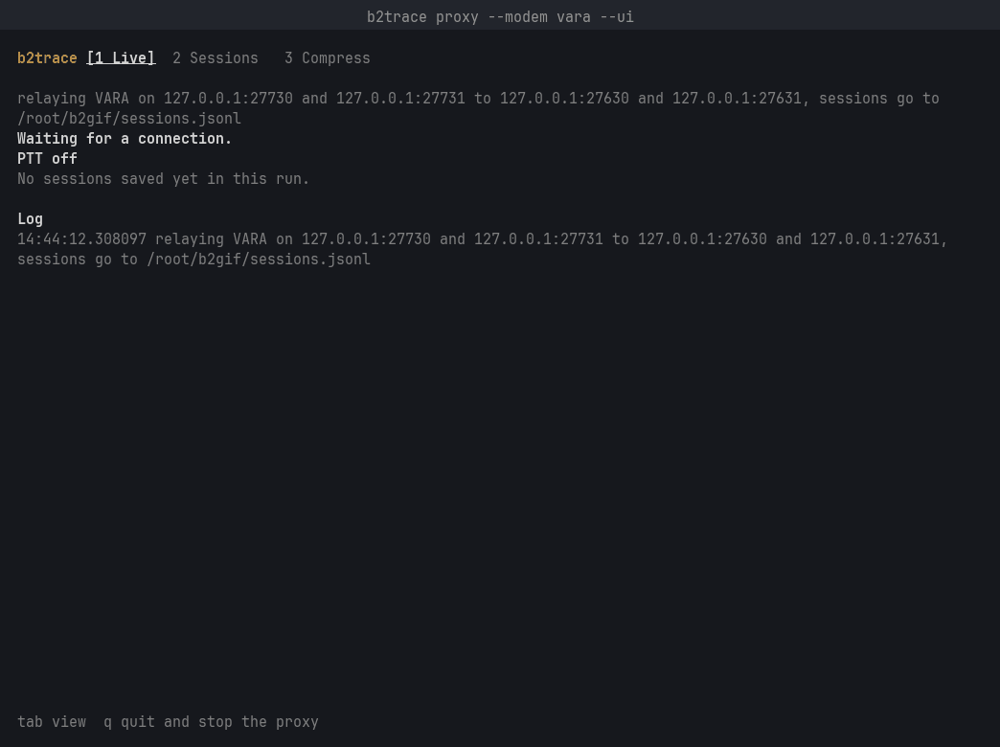
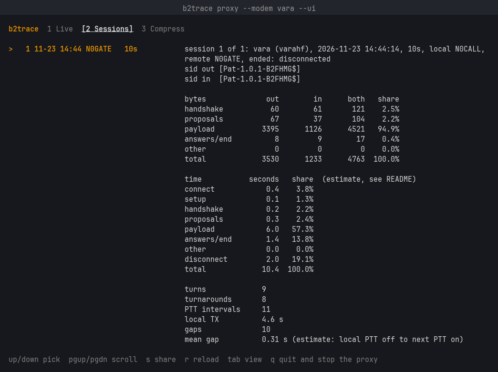
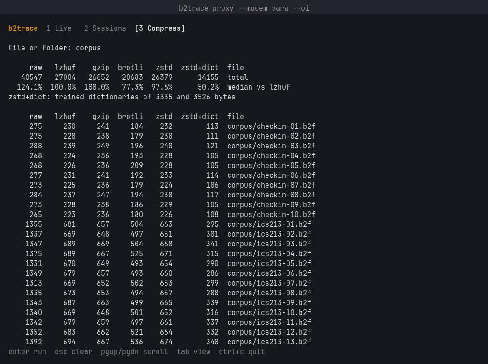

# b2trace

**See where the airtime goes in a Winlink B2F session.**

[](https://github.com/Londopy/b2trace/actions/workflows/ci.yml)
[](https://github.com/Londopy/b2trace/releases/latest)
[](https://github.com/Londopy/b2trace/releases/latest)
[](https://github.com/Londopy/b2trace/releases)
[](CHANGELOG.md)
[](go.mod)
[](LICENSE)
[](https://github.com/Londopy/b2trace/commits/main)


<p align="center">
  
</p>
<p align="center"><sub>Real Pat 1.0.1 at both ends, through a stand-in VARA modem that passes about 900 bytes a second. No radio was involved. Recorded in tmux.</sub></p>

b2trace is a passive TCP proxy that sits between Pat (or any Winlink client) and your VARA or
ARDOP sound-card modem, or a packet TNC such as Direwolf. It forwards every byte unchanged,
follows the B2F protocol in both directions, and writes one JSON line per session: how many
bytes and roughly how much time went to the handshake, the proposals, the messages and the
answers, how often the link turned around, and how long your own transmitter was keyed.

| | Command | What it does |
|---|---|---|
| 📡 | `b2trace proxy` | records every session between Pat and the modem, with `--ui` to watch it live |
| 💻 | `b2trace ui` | browses a session log, shares it and runs compress from one screen |
| 📊 | `b2trace summary` | breaks each session down by phase, turn and PTT time |
| 🔒 | `b2trace share` | strips callsigns, locators and titles so you can share the numbers |
| 📦 | `b2trace compress` | compares LZHUF, gzip, brotli and zstd on your own Winlink messages |

## Quick start

1. Download the archive for your system from
   [Releases](https://github.com/Londopy/b2trace/releases/latest) and unpack it, or with Go 1.26
   or newer:
   ```
   go install github.com/Londopy/b2trace@latest
   ```
2. Move VARA's TCP ports from 8300/8301 to 18300/18301 in its settings, then start the proxy
   in its place:
   ```
   b2trace proxy --modem vara --target 127.0.0.1:18300 --link varahf --ui
   ```
3. Use Pat as usual. Its address stays `localhost:8300`, which is now the proxy. Each session
   lands in `sessions.jsonl`; read it any time with:
   ```
   b2trace summary sessions.jsonl
   ```

The archives hold the one `b2trace` program for Windows (64-bit or ARM), Linux (64-bit, or ARM
for a Raspberry Pi with a 32- or 64-bit OS) and macOS. They are not code-signed, so check them
against `SHA256SUMS.txt` on the release page.

## Record sessions

The proxy takes the modem's usual port, so Pat needs no change, and passes everything on to the
modem on a port you move it to. Pick your modem:

<details>
<summary><b>VARA HF and VARA FM</b></summary>

VARA uses one port for commands and the next one for data, so each address below stands for a
pair.

1. In VARA's settings, move its TCP ports from 8300 and 8301 to 18300 (command) and 18301 (data).
2. Start the proxy:
   ```
   b2trace proxy --modem vara --target 127.0.0.1:18300 --link varahf
   ```
3. Use Pat as usual. Its `varahf` or `varafm` address stays `localhost:8300`, which is now the
   proxy.

VARA HF and VARA FM speak the same protocol, so b2trace cannot tell them apart. `--link` puts a
label of your choice on each session (`varahf`, `varafm`, `varahf-500`), which the results
table groups by. Without it, sessions are grouped by modem type.

</details>

<details>
<summary><b>ARDOP</b></summary>

1. Start the ARDOP TNC on port 18515 instead of 8515 (ardopc and ardopcf take the port as their
   first argument).
2. Start the proxy:
   ```
   b2trace proxy --modem ardop --target 127.0.0.1:18515
   ```
3. Pat's `ardop` address stays `localhost:8515`.

With ARDOP, Pat finds the data port by adding one to the last digit of the address, so if you
pass another address to `--listen`, pick a port that does not end in 9.

</details>

<details>
<summary><b>Packet over AGWPE (Direwolf, QtSoundModem, soundmodem)</b></summary>

AGWPE carries commands and data on one port.

1. Move the TNC's AGWPE port from 8000 to 18000. In `direwolf.conf` that is `AGWPORT 18000`.
2. Start the proxy:
   ```
   b2trace proxy --modem agwpe --target 127.0.0.1:18000 --link packet1200
   ```
3. Pat's `agwpe` address stays `localhost:8000`.

The TNC does not tell its clients when it keys the transmitter, so packet sessions have no
local TX time, gaps or retry hints. Everything else is recorded. Other programs can share the
TNC through the proxy, such as an APRS client; their frames are relayed but kept out of the
session Pat is in.

</details>

If Pat is set to another address, pass that address to `--listen`.

The proxy prints every command with a timestamp (on AGWPE, every frame other than data and the
frame counts Pat polls for several times a second). It appends a session to `sessions.jsonl`
(change it with `--log`) two seconds after the modem reports the disconnect, when a connection
to the modem closes, or when you stop the proxy with Ctrl+C. If the modem is not running, the
proxy closes Pat's connection and prints the address it could not reach.

## Watch sessions in the terminal UI

Add `--ui` to the proxy command to watch each session as it happens, or browse a log without
the proxy:

```
b2trace proxy --modem vara --target 127.0.0.1:18300 --ui
b2trace ui sessions.jsonl
```

<table>
  <tr>
    <td width="50%"></td>
    <td width="50%"></td>
  </tr>
  <tr>
    <td align="center"><sub>Sessions: every saved session with its full summary</sub></td>
    <td align="center"><sub>Compress: run on <code>corpus/</code> without leaving the UI</sub></td>
  </tr>
</table>

The UI has three views. `tab` and `shift+tab` move between them, and in Live and Sessions `1`,
`2` and `3` jump to one and `q` quits. `ctrl+c` quits from anywhere. With `--ui`, quitting also
stops the proxy, so while a session is in progress the UI asks first: press `q` or `ctrl+c`
again to stop it, or any other key to carry on.

| View | What it shows | Keys |
|---|---|---|
| **Live** | whether a station is connected and for how long, whether your PTT is keyed (AGWPE does not report it), the B2F phase now passing and who is sending, turns and messages so far, the byte and time tables, then as much of the proxy's log as fits. `idle` is the time since the last byte. | `t` switches tables in a window too narrow for both side by side (about 108 columns) |
| **Sessions** | the sessions in the log, newest selected first, with the full summary of the one you pick | `up`/`down` (or `j`/`k`, `g`/`G`) pick, `pgup`/`pgdn`/`space` scroll, `s` writes a shared copy, `r` reads the log again |
| **Compress** | `b2trace compress` on a file or folder you type or paste, totals at the top and a row per file below | `enter` runs, `pgup`/`pgdn` scroll, `esc` clears the path |

`s` works like `b2trace share`: it will not write over the log itself, and asks before replacing
another file. The colours follow your terminal's light or dark background when it reports one,
and use middle tones that read on either when it does not. Text keeps your terminal's own
colour, every state is also written in words, and `NO_COLOR` turns colour off. The UI is built
with [Bubble Tea](https://github.com/charmbracelet/bubbletea),
[Bubbles](https://github.com/charmbracelet/bubbles) and
[Lip Gloss](https://github.com/charmbracelet/lipgloss).

## Read the results

```
b2trace summary sessions.jsonl
```

It takes one log or several. For each session and for all of them together:

- the SIDs both sides sent, which show the protocol features each one offered
- bytes per phase in each direction and their share of all bytes
- an estimate of the time per phase (below)
- turns and turnarounds, local transmit time, and the mean gap between your transmissions
- the reply time: how long Pat took to answer each remote turn, from the remote's last byte to
  the first byte of Pat's next turn
- possible retries: times the modem's BUFFER report stayed the same and non-zero over two or
  more reports
- the proposals each way by code, and how the other side answered them: accepted, resumed from
  an offset, deferred, rejected, answered with a letter b2trace does not know, or not answered
  before the link dropped

<details>
<summary>Sample <code>b2trace summary</code> output (from the test data, not a real link)</summary>

```
session 1: vara (varahf), 2026-11-19 18:02:11, 3m10.4s, local N0CALL, remote N0GATE, ended: disconnected
sid out [PAT-0.17.0-B2FHM$]
sid in  [WL2K-5.0-B2FWIHJM$]

bytes              out        in      both   share
handshake          100       150       250   11.4%
proposals           60        50       110    5.0%
payload           1800         0      1800   81.8%
answers/end          4         9        13    0.6%
other                0        27        27    1.2%
total             1964       236      2200  100.0%

time           seconds   share  (estimate, see README)
connect            5.0    2.6%
setup              1.0    0.5%
handshake          5.4    2.8%
proposals          3.1    1.6%
payload          177.9   91.0%
answers/end        0.2    0.1%
other              0.9    0.5%
disconnect         2.0    1.0%
total            195.4  100.0%

turns             6
turnarounds       5
PTT intervals     3
local TX          12.3 s
gaps              2
mean gap          2.50 s (estimate: local PTT off to next PTT on)
reply time        0.67 s (mean, remote's last byte to your next byte)
possible retries  2 (BUFFER non-zero and unchanged for 2+ samples)
proposals out     1 (FC 1): 1 accepted
proposals in      0
messages          1 out, 0 in
errors            0
```

</details>

b2trace counts proposal codes without interpreting them. In wl2k-go, which Pat uses, FC is B2
compression (LZHUF) and FD is the gzip experiment Pat offers to peers with a G in their SID. FE
is not in any released client: it is the code of a proposed brotli extension, so seeing it
means both ends run a build with that extension.

The phases, as b2trace sorts each line or transfer:

| Phase | What is in it |
|---|---|
| handshake | the SID (`[...]`), `;FW`, `;PQ`, `;PR`, other `;` lines, MOTD and prompt lines, before that side's first F-command |
| pending | `;PM` pending-message lines (shown with proposals in the summary) |
| proposals | `FA` to `FE` proposals and the `F>` line that ends a block |
| answer | `FS` |
| payload | binary message transfers, header and block framing included |
| end | `FF` and `FQ` |
| error | lines starting with `***` |
| other | anything else after that side's first F-command |

**Time per phase.** The time table splits the whole session, from the connect command to the
disconnect, into:

- `connect`: from Pat's connect command to the modem's CONNECTED (0 for a session the remote
  started)
- `setup`: from CONNECTED to the first B2F byte
- one row per phase: each turn lasts from its first byte to the first byte of the next turn, so
  it takes in the turnaround and the start of the reply, and its time is shared between its
  phases by bytes
- `disconnect`: from the last B2F byte to the end of the session

Because it is built from when bytes passed the proxy, it works the same on every modem, but it
is an estimate: see [what one side can and cannot measure](#what-one-side-can-and-cannot-measure).

## Compare compressors

```
# Pat's mailbox on Windows (PowerShell)
b2trace compress "$env:LOCALAPPDATA\pat\mailbox\N0CALL"
# on Linux, as CSV
b2trace compress --csv ~/.local/share/pat/mailbox/N0CALL > sizes.csv
```

Give it files or directories (searched recursively): Pat's `.b2f` messages or any text files.
For each file it prints the raw size and the size after each of these, headers and checksums
included:

| Column | Settings |
|---|---|
| `lzhuf` | B2F's own compression, made with wl2k-go, including the 6-byte header |
| `gzip` | level 9 |
| `brotli` | quality 11, 4 MB window |
| `zstd` | level 19 |
| `zstd+dict` | level 19 with a dictionary of up to `--dict-size` bytes (default 16384) |

The footer has the total bytes per column and, per column, the median over files of the size
relative to LZHUF. [COMPRESSION.md](COMPRESSION.md) has the results on a corpus of 74 messages
written for this repository, in [`corpus/`](corpus/): ICS-213 forms, position reports,
radiograms, check-ins, spotter reports and hand-written messages.

<details>
<summary>How the zstd numbers are made</summary>

zstd comes from klauspost/compress, which maps level 19 to its best level; its authors put that
near zstd level 11, so the reference zstd at `-19` may do a little better.

For `zstd+dict`, the sorted files are split into two halves by odd and even position. Each half
is compressed with a dictionary trained on the other half, so no file helps compress itself.
Files with the same content as another file are left out for the same reason. With too few
files to train a dictionary, the column is skipped and the reason printed. The builder stops
when the samples run out of shared phrases, which can be well under `--dict-size`, so
`compress` prints the size of each dictionary it trained. It is also not deterministic: this
column can move by a point or two between runs, more for a single kind of message, while the
other columns always come out the same.

</details>

## Share your numbers

[RESULTS.md](RESULTS.md) collects sessions that people choose to share, so the numbers come
from real links. To add yours:

```
b2trace share -o varahf-2026-11-19.jsonl sessions.jsonl
```

`share` removes callsigns, locators, IP and email addresses, message titles and MIDs. It keeps
the numbers, the SIDs, the protocol keywords, your `--link` labels as you wrote them, and the
times, with your time zone's offset. Look the file over, then open a pull request that adds it
to `results/`. Your logs never leave your machine unless you do this. (Use `-o` rather than
`>`: Windows PowerShell 5 writes UTF-16 through `>`, which b2trace refuses to read.)

`b2trace results results/*.jsonl` prints the table on the results page, one row per link label.
It only reads files made by `share`. Patterns like `*.jsonl` work in PowerShell and cmd too,
which leave them to the program.

## What has been run against what

| | Against | What was run |
|---|---|---|
| ✅ | **Real Pat** | both ends of sessions through stand-in VARA and AGWPE links, with plain B2F and with the proposed Z extension, through `b2trace proxy` with and without `--ui` |
| 🟡 | **Real Direwolf 1.8.1** | Pat registering, dialing a station that did not answer, and Direwolf giving up, through the AGWPE proxy. A full session through Direwolf has not been run |
| ❌ | **VARA HF and FM** | never against the real VARA program. Tested with command and data traffic written in the tests and with a stand-in modem that answers Pat the way the VARA TCP interface does |
| ❌ | **ARDOP** | never against a real ARDOP TNC such as ardopcf. The framing was tested only with frames the tests build from the documented layout |
| ❌ | **On the air** | nothing yet. The numbers in this repository come from test data and stand-in links; real numbers belong in [RESULTS.md](RESULTS.md) |

## What one side can and cannot measure

b2trace sees only your end of the link.

| How sure | What | Why |
|---|---|---|
| Exact | your own transmit time | from the PTT messages the modem sends on its command port (`PTT ON`/`PTT OFF` from VARA, `PTT TRUE`/`PTT FALSE` from ARDOP). If your setup sends none, `local_tx_ms` stays 0 and there are no gaps. AGWPE never sends them |
| Exact | B2F bytes per phase and direction, turns, message sizes, proposals and answers | the proxy sees every byte, and the modem's commands and BUFFER reports as it sent them |
| Exact | the reply time | from the remote's last byte reaching Pat to Pat's first byte of the next turn. It is Pat's part of a turnaround only: the modem's decoding before it and keying after it are not in it, and the dead time on the air stays inside the gap |
| Estimated | the remote's transmit time and the turnaround dead time | b2trace never sees the remote's PTT. `gap_ms`, from your PTT going off to it coming on again, holds the remote's transmission plus the dead time on both sides of it, and one station cannot split those |
| Estimated | the time per phase | outgoing bytes can wait in the modem's buffer, and incoming bytes show up only after decoding, so a turn's time at the proxy is shifted from its airtime. Turns that mix phases share their time by bytes |
| Not airtime | byte shares | VARA compresses data itself, every modem adds framing and acknowledgements, and speed changes with conditions |
| A hint | possible retries | a BUFFER report that repeats a non-zero value means nothing was acknowledged in between, which is often a repeated frame, but the modem does not say so |

## JSON fields

One line per session. Times are RFC 3339 with milliseconds, in the time zone of the machine
running the proxy. `out` is what your station sent, `in` is what it received.

<details>
<summary>Every field in <code>sessions.jsonl</code></summary>

| Field | Meaning |
|---|---|
| `modem` | `vara`, `ardop` or `agwpe` |
| `link` | the `--link` label; left out when not set |
| `shared` | true in a file made by `b2trace share` |
| `start`, `end` | when the proxy saw CONNECTED and the disconnect, or when the session was cut short |
| `end_reason` | `disconnected`, `data connection closed`, `command connection closed`, `API connection closed`, `new CONNECTED` or `proxy stopped` |
| `connect_line` | the modem's CONNECTED line as sent, with the bandwidth; on AGWPE, the connect frame written as in `commands` |
| `connect_ms` | time from Pat's connect command to CONNECTED; left out for sessions the remote started |
| `local_call`, `remote_call` | from MYCALL (or the AGWPE registration) and the CONNECTED line; left out when unknown |
| `sid_out`, `sid_in` | the first SID each side sent: a handshake line in brackets that ends in `$]` |
| `bytes_out`, `bytes_in` | B2F bytes per phase: `handshake`, `pending`, `proposals`, `answer`, `payload`, `end`, `error`, `other` |
| `turn_count`, `turnarounds` | runs of data in one direction, and the changes of direction between them |
| `turns` | each turn: `dir`, `first_byte`, `last_byte` and `bytes` per phase |
| `local_tx_ms` | total time your PTT was on (exact) |
| `ptt` | each PTT interval: `on`, `off`, `local_tx_ms` |
| `gap_ms` | each time from a PTT OFF to the next PTT ON (estimate of remote transmit plus dead time) |
| `buffer` | each BUFFER report: `t`, `bytes`; over AGWPE, each change in the frames waiting for an acknowledgement |
| `buffer_unit` | `frames` for AGWPE; left out for bytes |
| `states` | ARDOP NEWSTATE and STATUS lines: `t`, `line` |
| `commands` | every command-port line but the BUFFER reports, from the end of the previous session (up to 50 lines before CONNECTED) to the end of this one: `t`, `dir`, `line`. Lines Pat sends after the disconnect go with the next session. On AGWPE, one line per frame on Pat's connection other than data and frame counts: kind, port, from, to, then the text of a connect or disconnect frame or the length of other data |
| `proposals` | each FA to FE line: `dir`, `code`, `mid`, `size`, `compressed_size`, `optimistic` (Z extension), and the other side's `answer` (`accept`, `reject`, `defer`, `resume`, or `other` for a letter b2trace does not know) with the resume `offset` |
| `messages` | each binary transfer: `dir`, `title`, `offset`, `compressed_size`, `complete` |
| `errors` | `***` lines and broken transfers: `t`, `dir`, `text` |

`compressed_size` in `messages` counts the data bytes in that transfer, which start at `offset`
when the transfer resumes an earlier one. `complete` is true when the transfer ended with a good
checksum. Titles are kept in your own log; message contents never are.

</details>

## How it works

Pat opens a command and a data connection to VARA and ARDOP, and one connection to an AGWPE
TNC. The proxy accepts each one and opens a matching one to the modem. It hands each chunk it
reads to the tracker before writing it on, so it has seen every event before the other side can
react.

<details>
<summary>Command port, data port, AGWPE and B2F parsing</summary>

- **Command port:** lines ending in `\r` both ways. CONNECTED starts a session, DISCONNECTED (or
  ARDOP's `NEWSTATE DISC`) ends it. The modem sends the last data and DISCONNECTED on different
  connections, so they can arrive in either order; a session stays open two more seconds for
  late data.
- **Data port:** VARA passes raw bytes. ARDOP frames them: host to TNC is a 2-byte big-endian
  length and the data, TNC to host is a length, a 3-letter type and the data. Only `ARQ` frames
  carry the B2F session.
- **AGWPE:** every frame has a 36-byte header with its kind, the two callsigns and the data
  length. `D` frames carry the session; a `C` frame from the TNC starts it, `d` ends it, and `Y`
  answers say how many frames are waiting for an acknowledgement.
- **B2F:** each direction is parsed byte by byte, so read boundaries do not matter. An element
  that starts with SOH (0x01) is a binary transfer: title, offset, STX blocks, then EOT and a
  checksum. Anything else is a text line ending in `\r`. A turn is a run of data in one
  direction; every change of direction is a turnaround. An FS line answers the open proposals
  from the other side, in order.

</details>

## Building from source

```
git clone https://github.com/Londopy/b2trace
cd b2trace
go build
go test ./...
```

<details>
<summary>Where things are</summary>

```
main.go       command dispatch and usage
tui.go        b2trace ui and proxy --ui
live.go       snapshots of the session in progress for the UI
proxy.go      listeners, relaying, command-port lines
agwpe.go      AGWPE framing
ardop.go      ARDOP data-port framing
tracker.go    turns what the proxy sees into sessions
b2f.go        the passive B2F parser
session.go    the session written to the JSONL log
summary.go    b2trace summary
share.go      b2trace share
results.go    b2trace results
compress.go   b2trace compress
testdata/     JSONL input for the summary test
corpus/       the messages COMPRESSION.md measures
scripts/      corpus generator, compression tables and release notes
docs/         the images in this README
```

</details>

## Contributing

Issues and pull requests are welcome; see [CONTRIBUTING.md](CONTRIBUTING.md). Add a line under
`Unreleased` in [CHANGELOG.md](CHANGELOG.md) with any change.

## License

MIT, see [LICENSE](LICENSE).
